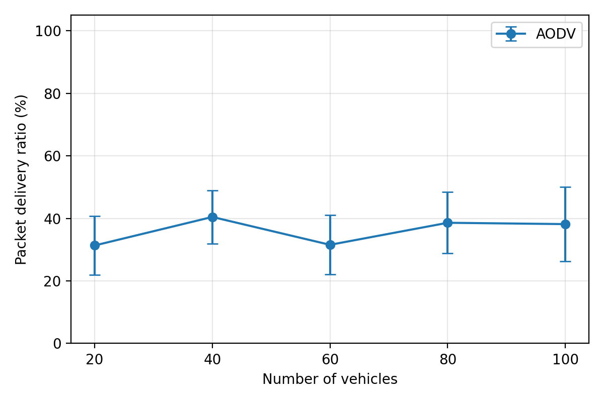
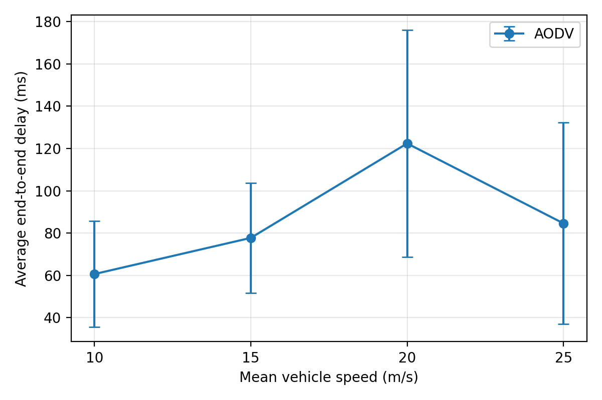
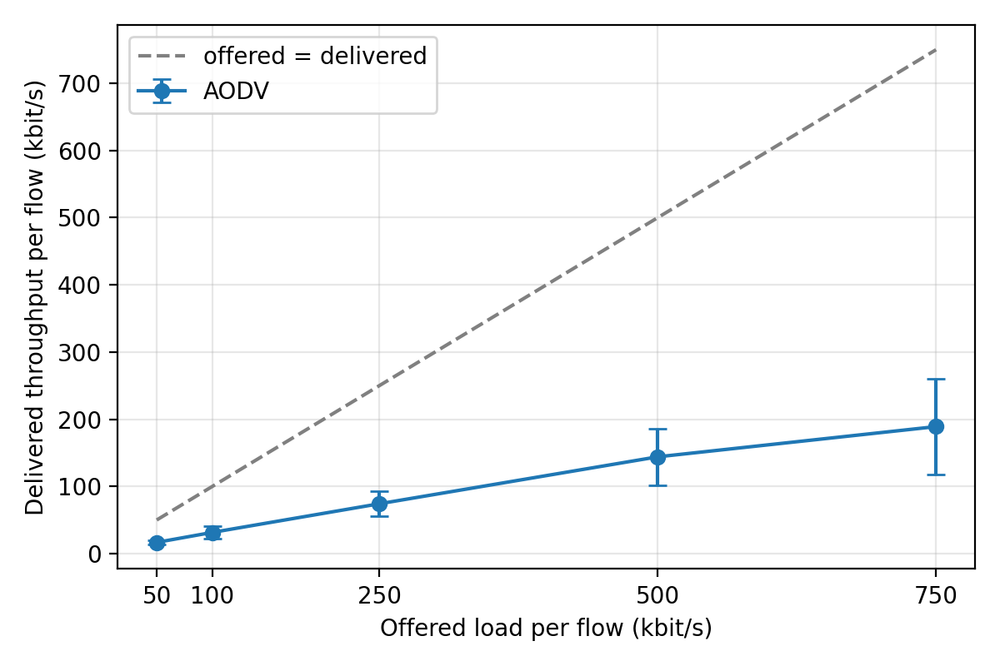
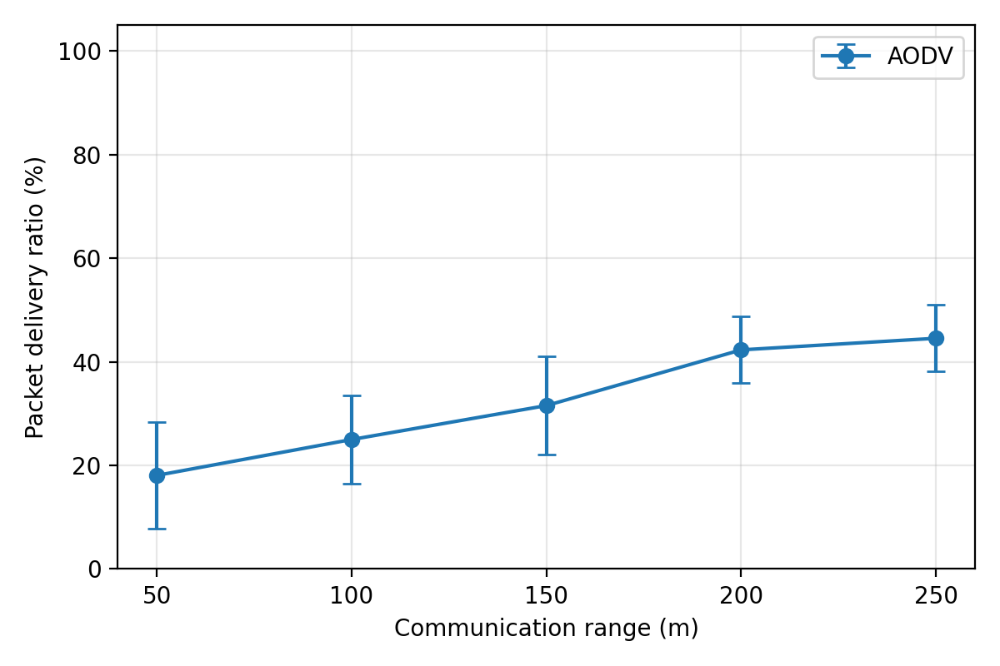

# Performance Analysis of VANETs for Traffic Efficiency and Road Traffic Safety Using NS-3

An NS-3 (ns-3.45) simulation study of a vehicular ad hoc network (VANET) on a highway.
Vehicles route with **AODV** over an **IEEE 802.11p** radio and exchange UDP traffic.
We vary vehicle density, vehicle speed, traffic load and communication range one at a time and measure
**packet delivery ratio (PDR)**, **end-to-end delay**, **throughput** and **packet loss rate**.

Network Programming – Alternate Assessment (AAT), Team 9:
Zain Mahedi, Thanish A Shetty, Vaibhav S Keerthi, Vikas Shashi.

Reference framework: M. Malnar and N. Jevtić, "A Framework for Performance Evaluation of VANETs Using NS-3
Simulator," *Promet – Traffic & Transportation*, vol. 32, no. 2, pp. 255–268, 2020.
[doi:10.7307/ptt.v32i2.3227](https://doi.org/10.7307/ptt.v32i2.3227)

## Repository contents

| File | Purpose |
|---|---|
| [`vanet-highway.cc`](vanet-highway.cc) | NS-3 scenario (goes in `scratch/`). One run → one CSV row of results |
| [`run_experiments.sh`](run_experiments.sh) | Runs all four parameter sweeps × 5 random seeds (95 runs) in parallel |
| [`plot_results.py`](plot_results.py) | Merges the runs, computes mean ± standard deviation, draws the graphs |
| [`results/`](results) | Our results: `all_runs.csv`, `summary.csv` and the four graphs in `plots/` |

## Simulation scenario

| Setting | Value |
|---|---|
| Road | Straight highway, 2000 m, 2 lanes in each direction (5 m apart). A vehicle leaving one end re-enters at the other, so density stays constant |
| Mobility | Constant velocity. Each vehicle's speed is the mean speed × U(0.8, 1.2), so vehicles overtake each other |
| PHY/MAC | `WIFI_STANDARD_80211p` (5.9 GHz band, 10 MHz channel), constant 6 Mbit/s (`OfdmRate6MbpsBW10MHz`), 20 dBm, ad hoc MAC |
| Communication range | Hard cutoff: `RangePropagationLossModel` with `MaxRange` = range |
| Routing | AODV |
| Traffic | 10 constant-rate UDP flows (`OnOffApplication` → `PacketSink`), 512-byte payload. Distinct random senders, random receivers |
| Timing | 100 s simulation. Flows start at a random time in 10–11 s and stop at 95 s |
| Measurement | `FlowMonitor`, data flows only (AODV control traffic is excluded) |

Note: ns-3 no longer includes the `wave` module, which provided the 802.11p OCB MAC. The 802.11p PHY
is configured through the `wifi` module, with an ad hoc MAC.

### Experiments

Baseline: **60 vehicles, 20 m/s, 100 kbit/s per flow, 150 m range**. Each sweep varies one parameter:

| Sweep | Values | Graph |
|---|---|---|
| Vehicle density | 20, 40, 60, 80, 100 vehicles | Density vs PDR |
| Vehicle speed | 10, 15, 20, 25 m/s (mean) | Speed vs end-to-end delay |
| Traffic load | 50, 100, 250, 500, 750 kbit/s per flow | Offered load vs delivered throughput |
| Communication range | 50, 100, 150, 200, 250 m | Range vs PDR |

Each test point runs with 5 seeds (`--RngRun=1..5`). The graphs show the mean with standard-deviation error bars.

### Metrics

- **PDR (%)** = data packets received / data packets sent × 100 (over all flows)
- **End-to-end delay (ms)** = total delay of received packets / packets received
- **Throughput (kbit/s per flow)** = mean over flows of (packets received × 512 B × 8 / time the flow was sending).
  This counts payload only, so it compares directly with the offered rate
- **Packet loss rate (%)** = (sent − received) / sent × 100

## Results

| | |
|---|---|
|  |  |
|  |  |

Mean ± std over 5 seeds (full table in [`results/summary.csv`](results/summary.csv)):

| Sweep | PDR (%) | Delay (ms) | Throughput (kbit/s per flow) |
|---|---|---|---|
| Range 50 → 250 m | 18.1 ± 10.2 → 44.5 ± 6.4 | 314.9 → 59.3 | 18.1 → 44.5 |
| Speed 10 → 25 m/s | 37.4 ± 6.5 → 34.5 ± 5.5 | 60.6 → 84.6 | 37.4 → 34.4 |
| Load 50 → 750 kbit/s | 33.3 ± 5.5 → 25.2 ± 9.5 | 279.7 → 63.4 | 16.7 → 189.0 |
| Density 20 → 100 vehicles | 31.3 ± 9.4 → 38.2 ± 11.8 | 170.8 → 49.5 | 31.3 → 38.2 |

Observations:

- **Communication range has the strongest effect.** PDR rises from 18% at 50 m to 45% at 250 m, and delay falls from about 315 ms to about 60 ms,
  because longer links mean fewer hops and fewer route breaks.
- **Throughput falls further below the offered load as load grows.** Delivered throughput is about a third of the offered rate at
  50 kbit/s and about a quarter at 750 kbit/s, as the shared 6 Mbit/s channel saturates.
- **PDR is low overall (about 30–45%).** Vehicles in opposite lanes separate at roughly 40 m/s, so multi-hop AODV routes break within seconds.
  Single-hop delivery is close to 100% in the same scenario, so the losses come from route maintenance under mobility, not from the radio.
- **Density and speed effects are smaller than the run-to-run variation at 5 seeds** (standard deviation about 5–12 PDR points).
  More seeds (e.g. `SEEDS=10`) would be needed to separate them clearly.

## How to run

Requirements: Ubuntu (or WSL), ns-3.45 built from [nsnam.org](https://www.nsnam.org/), Python 3 with `matplotlib` and `numpy`.

1. Build ns-3.45:

   ```bash
   tar xjf ns-allinone-3.45.tar.bz2
   cd ns-allinone-3.45/ns-3.45
   ./ns3 configure --enable-examples --enable-tests
   ./ns3 build
   ```

2. Run all experiments from this repository (copies the scenario into `scratch/`, builds it, runs 95 simulations in parallel):

   ```bash
   NS3_DIR=~/ns-allinone-3.45/ns-3.45 bash run_experiments.sh
   ```

   Options: `SEEDS=10` (seeds per test point), `JOBS=4` (parallel runs), `OUT=dir` (output directory).
   An interrupted batch can be restarted with the same command; finished runs are skipped.

3. Draw the graphs and summary table:

   ```bash
   python3 plot_results.py results
   ```

A single run:

```bash
cp vanet-highway.cc ~/ns-allinone-3.45/ns-3.45/scratch/
cd ~/ns-allinone-3.45/ns-3.45
./ns3 run "vanet-highway --nVehicles=60 --speed=20 --dataRateKbps=100 --range=150 --RngRun=1"
./ns3 run "vanet-highway --PrintHelp"   # list all options
```
