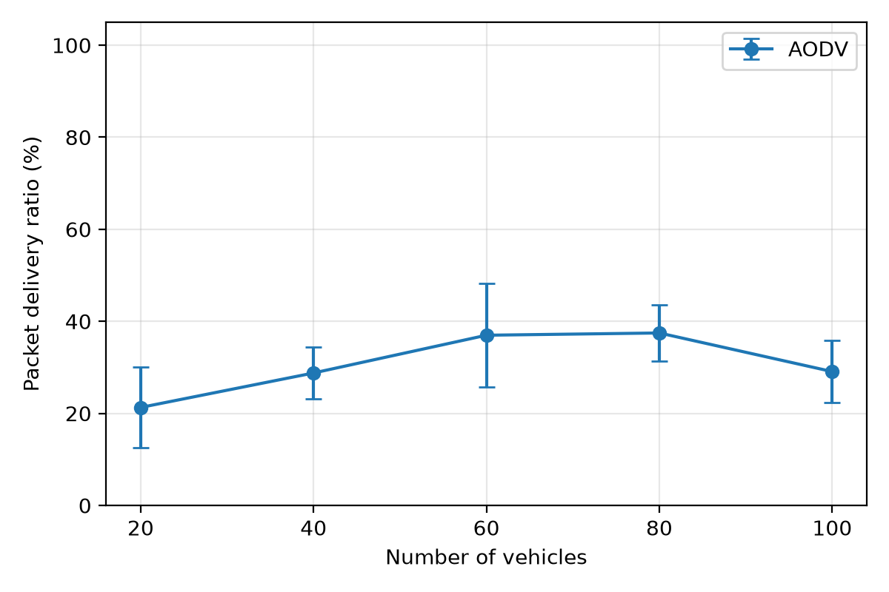
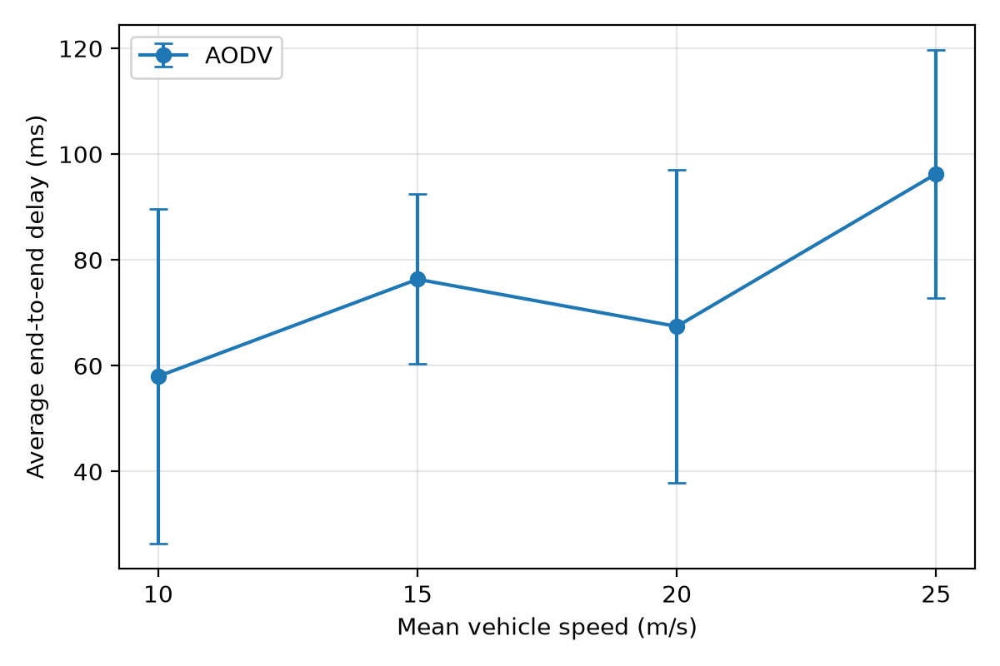
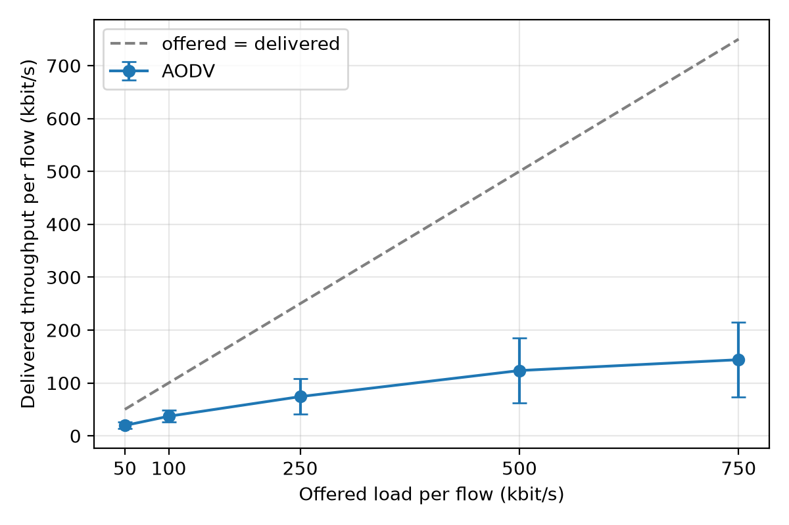
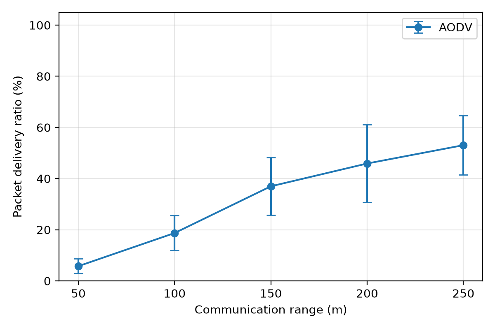
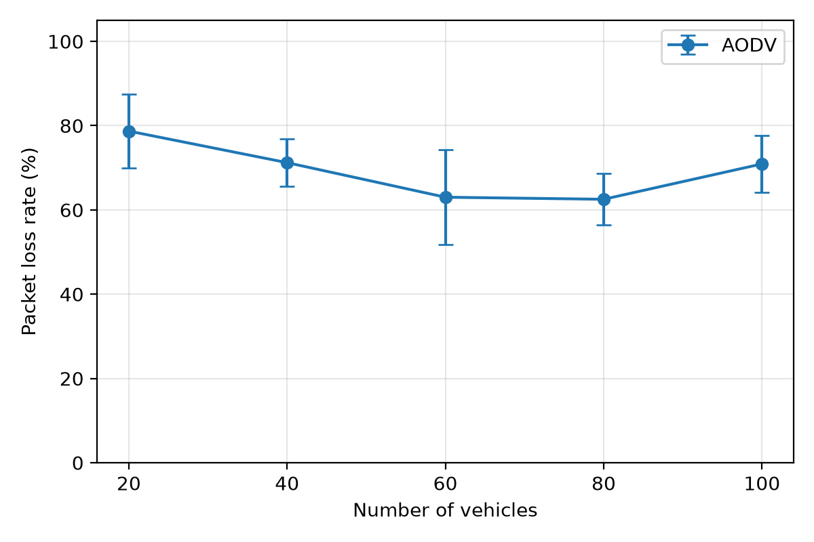
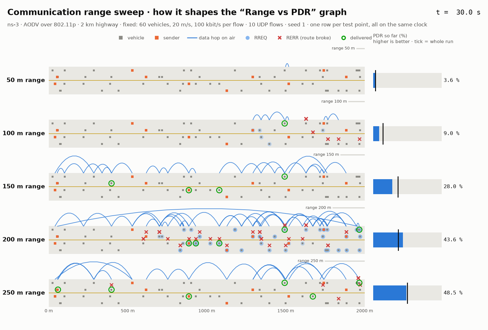
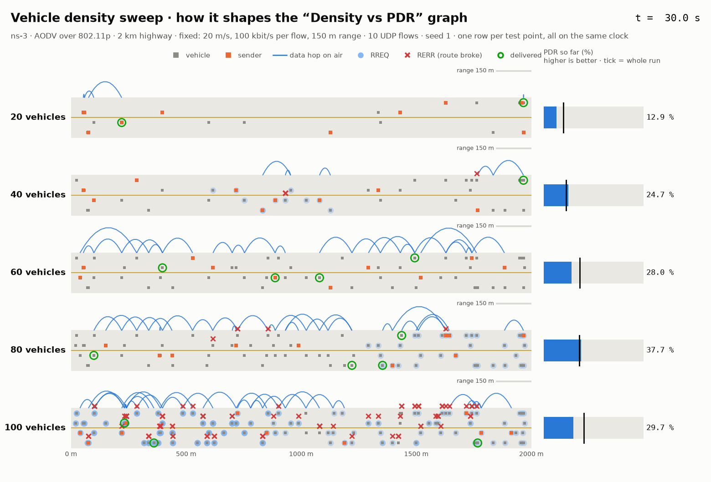
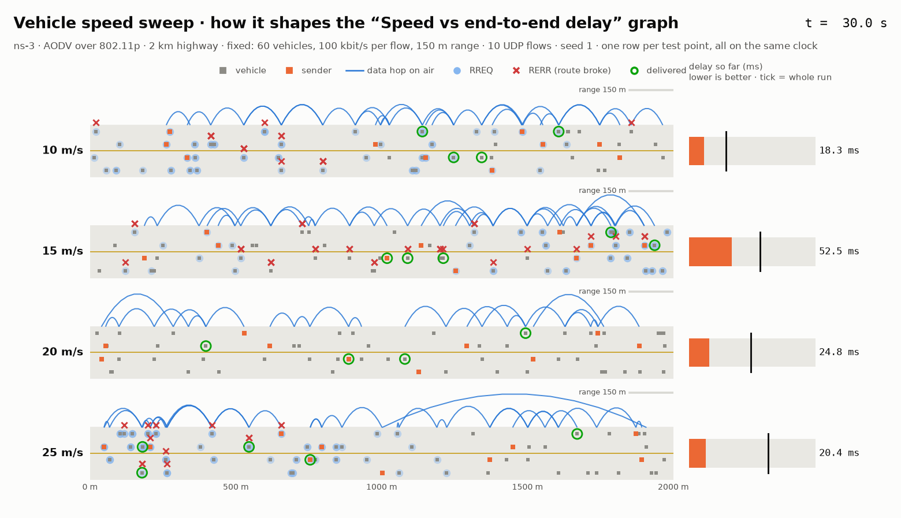
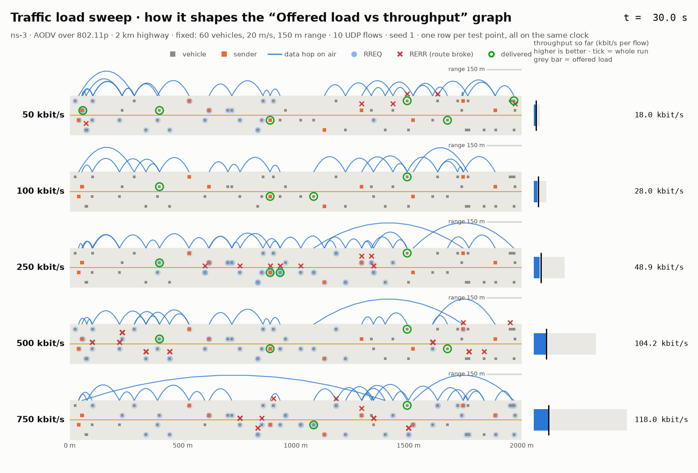

# Performance Analysis of VANETs for Traffic Efficiency and Road Traffic Safety Using NS-3

An NS-3 simulation study (written for ns-3.45; the results here were produced with ns-3.48) of a vehicular ad hoc network (VANET) on a highway.
Vehicles route with **AODV** over an **IEEE 802.11p** radio and exchange UDP traffic.
We vary vehicle density, vehicle speed, traffic load and communication range one at a time and measure
**packet delivery ratio (PDR)**, **end-to-end delay**, **throughput** and **packet loss rate**.

Network Programming – Alternate Assessment (AAT), Team 9:
Zain Mahedi, Thanish A Shetty, Vaibhav S Keerthi, Vikas Shashi.

Reference framework: M. Malnar and N. Jevtić, "A Framework for Performance Evaluation of VANETs Using NS-3
Simulator," *Promet – Traffic & Transportation*, vol. 32, no. 2, pp. 255–268, 2020.
[doi:10.7307/ptt.v32i2.3227](https://doi.org/10.7307/ptt.v32i2.3227)

## Repository contents

| File | Purpose |
|---|---|
| [`vanet-highway.cc`](vanet-highway.cc) | NS-3 scenario (goes in `scratch/`). One run → one CSV row of results |
| [`run_experiments.sh`](run_experiments.sh) | Runs all four parameter sweeps × 5 random seeds (95 runs) in parallel |
| [`plot_results.py`](plot_results.py) | Merges the runs, computes mean ± standard deviation, draws the graphs |
| [`animate_trace.py`](animate_trace.py) | Animates one traced run (`--trace`) as a GIF/MP4 of vehicles, routes and packets |
| [`animate_sweep.py`](animate_sweep.py) | Animates all test points of one sweep side by side |
| [`make_animations.sh`](make_animations.sh) | Runs every sweep point with `--trace` and `--netanim` and draws all animations |
| [`results/`](results) | Our results: `all_runs.csv`, `summary.csv` and the five graphs in `plots/` |
| [`report/`](report) | AAT report ([PDF](report/VANET_NS3_AAT_Report.pdf), [Word](report/VANET_NS3_AAT_Report.docx)) and the scripts that build it from `results/` (`bash report/build.sh`; needs LibreOffice and `pip install -r report/requirements.txt`) |

## Simulation scenario

| Setting | Value |
|---|---|
| Road | Straight highway, 2000 m, 2 lanes in each direction (5 m apart). A vehicle leaving one end re-enters at the other, so density stays constant |
| Mobility | Constant velocity. Each vehicle's speed is the mean speed × U(0.8, 1.2), so vehicles overtake each other |
| PHY/MAC | `WIFI_STANDARD_80211p` (5.9 GHz band, 10 MHz channel), constant 6 Mbit/s (`OfdmRate6MbpsBW10MHz`), 20 dBm, ad hoc MAC |
| Communication range | Hard cutoff: `RangePropagationLossModel` with `MaxRange` = range |
| Routing | AODV |
| Traffic | 10 constant-rate UDP flows (`OnOffApplication` → `PacketSink`), 512-byte payload. Distinct random senders, random receivers |
| Timing | 100 s simulation. Flows start at a random time in 10–11 s and stop at 95 s |
| Measurement | `FlowMonitor`, data flows only (AODV control traffic is excluded) |

Note: ns-3 no longer includes the `wave` module, which provided the 802.11p OCB MAC. The 802.11p PHY
is configured through the `wifi` module, with an ad hoc MAC.

### Experiments

Baseline: **60 vehicles, 20 m/s, 100 kbit/s per flow, 150 m range**. Each sweep varies one parameter:

| Sweep | Values | Graph |
|---|---|---|
| Vehicle density | 20, 40, 60, 80, 100 vehicles | Density vs PDR |
| Vehicle speed | 10, 15, 20, 25 m/s (mean) | Speed vs end-to-end delay |
| Traffic load | 50, 100, 250, 500, 750 kbit/s per flow | Offered load vs delivered throughput |
| Communication range | 50, 100, 150, 200, 250 m | Range vs PDR |

Each test point runs with 5 seeds (`--RngRun=1..5`). The graphs show the mean with standard-deviation error bars.

### Metrics

- **PDR (%)** = data packets received / data packets sent × 100 (over all flows)
- **End-to-end delay (ms)** = total delay of received packets / packets received
- **Throughput (kbit/s per flow)** = mean over flows of (packets received × 512 B × 8 / time the flow was sending).
  This counts payload only, so it compares directly with the offered rate
- **Packet loss rate (%)** = (sent − received) / sent × 100

## Results

| | |
|---|---|
|  |  |
|  |  |
|  | |

Mean ± std over 5 seeds (full table in [`results/summary.csv`](results/summary.csv)):

| Sweep | PDR (%) | Delay (ms) | Throughput (kbit/s per flow) |
|---|---|---|---|
| Range 50 → 250 m | 5.8 ± 2.9 → 53.1 ± 11.6 | 360.5 → 34.1 | 5.8 → 53.0 |
| Speed 10 → 25 m/s | 46.1 ± 14.7 → 32.3 ± 9.5 | 58.0 → 96.3 | 46.1 → 32.3 |
| Load 50 → 750 kbit/s | 39.2 ± 12.3 → 19.2 ± 9.4 | 151.1 → 77.2 | 19.6 → 143.9 |
| Density 20 → 100 vehicles | 21.3 ± 8.7 → 29.1 ± 6.7 (peak 37.5 at 80) | 229.5 → 37.7 | 21.3 → 29.1 |

Observations:

- **Communication range has the strongest effect.** PDR rises from 6% at 50 m to 53% at 250 m, and delay falls from about 360 ms
  to about 35 ms. At 50 m the road splits into isolated groups of vehicles, so most packets wait for a route that never forms.
- **Faster vehicles lose more packets.** PDR falls steadily from 46% at 10 m/s to 32% at 25 m/s. Delay goes from 58 to 96 ms,
  with a dip at 20 m/s that is inside the error bars. Both happen because
  links between vehicles break sooner and AODV spends more time rediscovering routes.
- **Throughput falls further below the offered load as load grows.** Delivered throughput is about 40% of the offered rate at
  50 kbit/s and about 19% at 750 kbit/s, as the shared 6 Mbit/s channel saturates.
- **Density helps up to a point.** PDR rises from 21% with 20 vehicles to about 37% with 60–80, as the road becomes connected,
  then drops to 29% with 100 vehicles, as route discovery floods and contention grow.
- **Run-to-run variation is large** (standard deviation about 6–15 PDR points at 5 seeds), so neighbouring test points can overlap.
  More seeds (e.g. `SEEDS=10`) would separate them more clearly.

Bug fix (November 2026): earlier results were produced while vehicles stopped permanently after their first wrap-around,
because ns-3's `ConstantVelocityMobilityModel::SetPosition` also sets the velocity to zero. By t = 60 s about two thirds
of the vehicles were parked. `WrapPositions` now restores the velocity, and every result above was regenerated.

## How to run

Requirements: Ubuntu (or WSL), ns-3.45 built from [nsnam.org](https://www.nsnam.org/), Python 3 with `matplotlib` and `numpy`.

1. Build ns-3.45:

   ```bash
   tar xjf ns-allinone-3.45.tar.bz2
   cd ns-allinone-3.45/ns-3.45
   ./ns3 configure --enable-examples --enable-tests
   ./ns3 build
   ```

2. Run all experiments from this repository (copies the scenario into `scratch/`, builds it, runs 95 simulations in parallel):

   ```bash
   NS3_DIR=~/ns-allinone-3.45/ns-3.45 bash run_experiments.sh
   ```

   Options: `SEEDS=10` (seeds per test point), `JOBS=4` (parallel runs), `OUT=dir` (output directory).
   An interrupted batch can be restarted with the same command; finished runs are skipped.

3. Draw the graphs and summary table:

   ```bash
   python3 plot_results.py results
   ```

A single run:

```bash
cp vanet-highway.cc ~/ns-allinone-3.45/ns-3.45/scratch/
cd ~/ns-allinone-3.45/ns-3.45
./ns3 run "vanet-highway --nVehicles=60 --speed=20 --dataRateKbps=100 --range=150 --RngRun=1"
./ns3 run "vanet-highway --PrintHelp"   # list all options
```

### Visualising the sweeps (animations and NetAnim)

Two options make a run record what happens inside it. Neither changes the results row.

- `--trace=FILE` writes packet-level events: vehicle positions, every data frame on air,
  AODV RREQ/RREP/RERR/hello frames, packets sent and delivered.
- `--netanim=FILE.xml` writes a [NetAnim](https://www.nsnam.org/wiki/NetAnim) animation of the same run
  (from t = 0 to `--netanimStop`, default 30 s; the flows start at about 10 s). Senders are orange, receivers are
  green, and each vehicle is labelled with its flow, e.g. `v20 TX-F1`, `v38 RX-F1`.

`make_animations.sh` runs one seed of every test point in the four sweeps with both options on, then
draws the animations:

```bash
NS3_DIR=~/ns-allinone-3.45/ns-3.45 bash make_animations.sh     # SEED=1 by default
```

| Output in `results/animations/` | What it is |
|---|---|
| `<sweep>_sweep.gif` | All values of one sweep stacked on one clock, with a live bar of the metric that sweep's graph plots ([`animate_sweep.py`](animate_sweep.py)) |
| `<sweep>/<sweep>_<value>.gif` | One test point, titled with the sweep, its graph, the varied value and the fixed settings ([`animate_trace.py`](animate_trace.py)) |
| `netanim/<sweep>_<value>.xml` | The same run for NetAnim |
| `*_t30.png` | Snapshots at t = 30 s (the only files committed; the rest is regenerated) |

To view a NetAnim file, build NetAnim (it needs Qt 6, e.g. `brew install qt`), then open the XML from its
File menu:

```bash
git clone --branch netanim-3.110 https://gitlab.com/nsnam/netanim.git
cmake -S netanim -B netanim/build && cmake --build netanim/build -j
netanim/build/bin/netanim
```

All runs use the same seed, so vehicles start in the same places in every row of a sweep. One seed is
not the 5-seed mean in the graphs, so a single run can differ from the trend: with seed 1, 100 vehicles
reach 40% PDR, although the 5-seed mean drops to 29% there.

| Range vs PDR | Density vs PDR |
|---|---|
|  |  |
| **Speed vs delay** | **Load vs throughput** |
|  |  |
